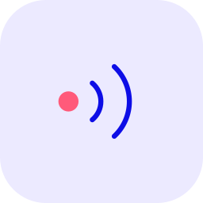

<div align="center">
  
  <h1>@upfluence/hyperevents</h1>
  <p>Ember addon for activity tracking and websocket event subscriptions.</p>

[](https://github.com/upfluence/hyperevents/actions/workflows/ci.yml)
[](https://sonarqube.upfluence.co/dashboard?id=hyperevents)
[](https://sonarqube.upfluence.co/dashboard?id=hyperevents)
[](https://sonarqube.upfluence.co/dashboard?id=hyperevents)
[](https://sonarqube.upfluence.co/dashboard?id=hyperevents)

[Compatibility](#compatibility) •
[Installation](#installation) •
[Usage](#usage) •
[Contributing](#contributing) •
[License](#license)

</div>

## Compatibility

- Ember.js v6.12 or above
- Node.js v24 or above
- pnpm 10

Apps on Ember.js below 6.12 should stay on `1.x`.

Required peer dependency: `ember-source` `^6.12.0`.

## Installation

```
pnpm add @upfluence/hyperevents
```

## Usage

### Build-time configuration

Apps should provide activity metadata through `@embroider/macros`:

```js
'@embroider/macros': {
  setConfig: {
    '@upfluence/hyperevents': {
      buildEnv: process.env.BUILD_ENV || 'staging',
      activityUrl: process.env.ACTIVITY_URL || 'https://activity.upfluence.com',
      parentAppVersion: '<app version>'
    }
  }
}
```

`buildEnv` falls back to `staging` and `parentAppVersion` falls back to `unknown`.

## Contributing

See the [Contributing](CONTRIBUTING.md) guide for details.

### Releasing

This project uses [release-it](https://github.com/release-it/release-it) with Workspaces support brought by the official
[Release-it Workspace plugin](https://github.com/release-it-plugins/workspaces).

To cut a new release, run `pnpm release-it` and follow the prompt questions.

For an explicit version bump, run `pnpm release-it patch`, `pnpm release-it minor`, or `pnpm release-it major`.

To release a beta version, run `pnpm release-it --preRelease=beta` and follow the prompt questions.

## License

The published `@upfluence/hyperevents` addon package is licensed under the [MIT License](LICENSE.md).
